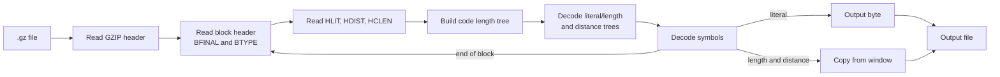

# GZIP / DEFLATE Decompressor

A decompressor for `.gz` files written from scratch in Python. It parses the GZIP header, reads the DEFLATE blocks, rebuilds the dynamic Huffman trees and decodes the LZ77 literals and length/distance pairs to restore the original file.

University project for the *Teoria da Informação* (Information Theory) course, Computer Engineering (LEI), University of Coimbra, 2023.

## Features

- GZIP header parsing (ID, compression method, flags, modification time, original file name, extra fields, comment and header CRC)
- Dynamic Huffman block decoding: reads `HLIT`, `HDIST` and `HCLEN`, the code length alphabet and builds the literal/length and distance trees
- LZ77 decoding: copies from the sliding window, including back-references that reach into the previous block
- Handles multi-block files
- Writes the decompressed data to a file with the name stored in the GZIP header

## How it works



## Project Structure

| File | Contents |
|---|---|
| `Deflate.py` | `GZIPHeader` and `GZIP` classes: header reading, block parsing, tree decoding and LZ77 decoding |
| `huffmantree.py` | Huffman tree used to decode the bit stream |

## Limitations

- Only blocks compressed with **dynamic Huffman codes** (`BTYPE = 10`) are supported. Stored and fixed Huffman blocks, which gzip uses for very small inputs, are reported as errors
- The output file is named after the file name stored in the GZIP header, so archives created without a name (for example from standard input) fail

## Tech Stack

Python 3 · NumPy

## Getting Started

### Prerequisites

Python 3.8 or later.

### Installation

```bash
pip install -r requirements.txt
```

### Usage

```bash
python Deflate.py path/to/file.txt.gz
```

The decompressed file is written to the current directory, with the original name. To try it, compress any reasonably large text file with `gzip` and decompress it again:

```bash
gzip -k notes.txt
mkdir out && cd out
python ../Deflate.py ../notes.txt.gz
cmp notes.txt ../notes.txt
```

## Credits

The structure of `GZIPHeader` and `GZIP` and the `huffmantree.py` module are base code provided by the course, by Marco Simões, adapted from the Java implementation of Rui Pedro Paiva. The block decoding, tree construction and LZ77 decoding were implemented as the project work.

## Authors

Alexandre Fonseca, Simão Carvalho, Yelizaveta Bila · University of Coimbra · Computer Engineering · 2023
